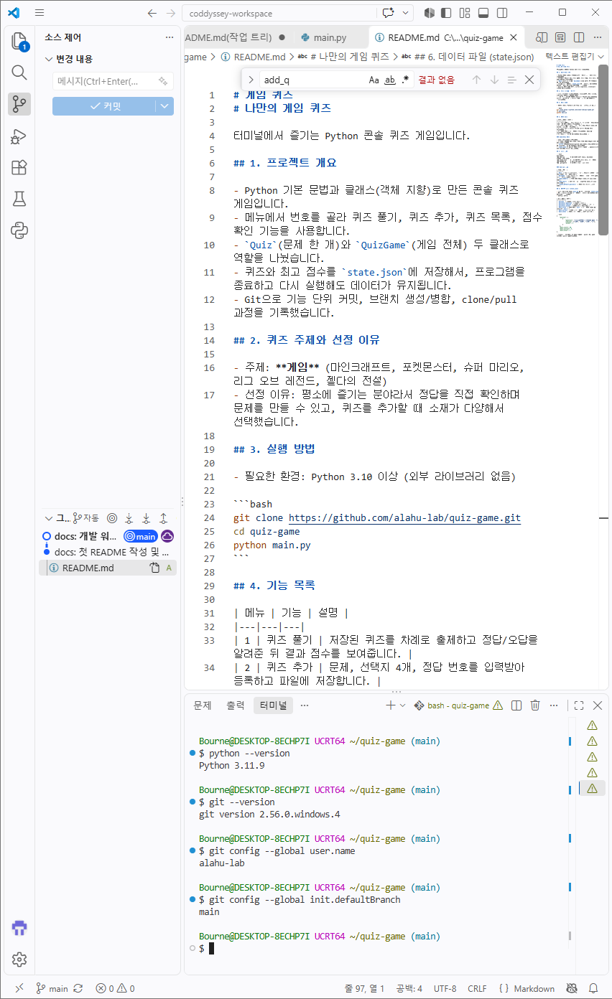
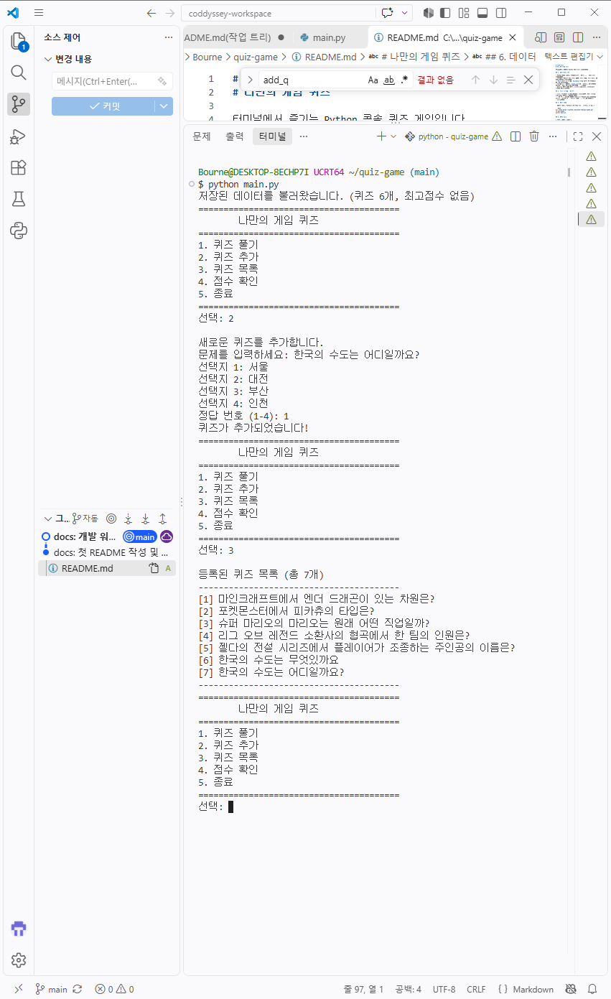
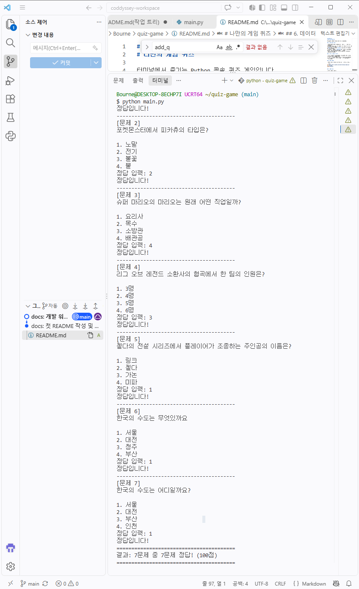
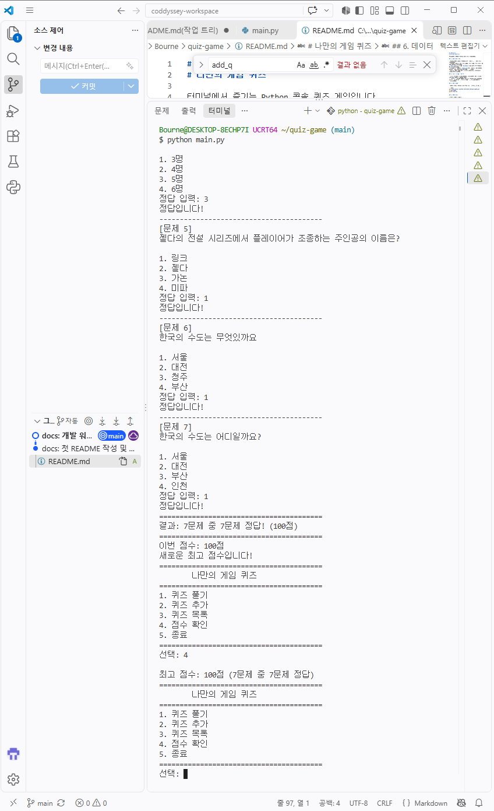
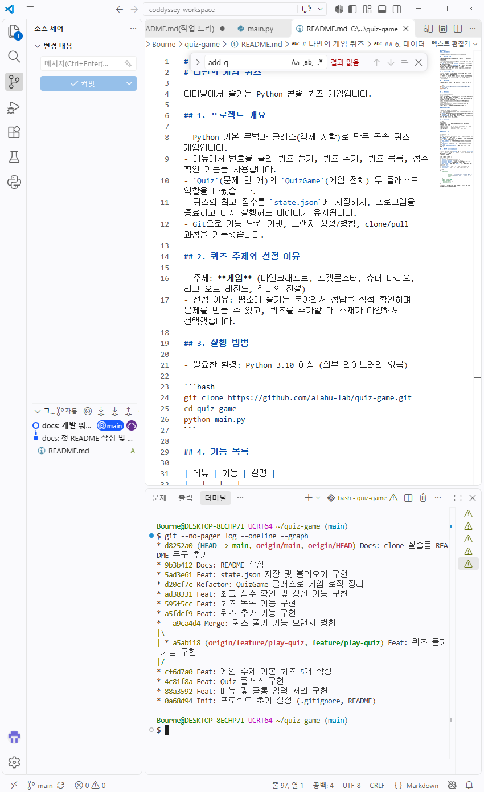

# 나만의 게임 퀴즈

터미널에서 즐기는 Python 콘솔 퀴즈 게임입니다.

## 1. 프로젝트 개요

- Python 기본 문법과 클래스(객체 지향)로 만든 콘솔 퀴즈 게임입니다.
- 메뉴에서 번호를 골라 퀴즈 풀기, 퀴즈 추가, 퀴즈 목록, 점수 확인 기능을 사용합니다.
- `Quiz`(문제 한 개)와 `QuizGame`(게임 전체) 두 클래스로 역할을 나눴습니다.
- 퀴즈와 최고 점수를 `state.json`에 저장해서, 프로그램을 종료하고 다시 실행해도 데이터가 유지됩니다.
- Git으로 기능 단위 커밋, 브랜치 생성/병합, clone/pull 과정을 기록했습니다.

## 2. 퀴즈 주제와 선정 이유

- 주제: **게임** (마인크래프트, 포켓몬스터, 슈퍼 마리오, 리그 오브 레전드, 젤다의 전설)
- 선정 이유: 평소에 즐기는 분야라서 정답을 직접 확인하며 문제를 만들 수 있고, 퀴즈를 추가할 때 소재가 다양해서 선택했습니다.

## 3. 실행 방법

- 필요한 환경: Python 3.10 이상 (외부 라이브러리 없음)

```bash
git clone https://github.com/alahu-lab/quiz-game.git
cd quiz-game
python main.py
```

## 4. 기능 목록

| 메뉴 | 기능 | 설명 |
|---|---|---|
| 1 | 퀴즈 풀기 | 저장된 퀴즈를 차례로 출제하고 정답/오답을 알려준 뒤 결과 점수를 보여줍니다. |
| 2 | 퀴즈 추가 | 문제, 선택지 4개, 정답 번호를 입력받아 등록하고 파일에 저장합니다. |
| 3 | 퀴즈 목록 | 등록된 퀴즈의 문제를 번호와 함께 보여줍니다. |
| 4 | 점수 확인 | 최고 점수를 보여줍니다. 아직 풀지 않았다면 안내합니다. |
| 5 | 종료 | 저장 후 프로그램을 종료합니다. |

### 입력/예외 처리

- 입력 앞뒤 공백을 제거합니다.
- 빈 입력, 숫자가 아닌 입력, 허용 범위 밖의 숫자는 안내 후 다시 입력받습니다.
- `Ctrl+C`(KeyboardInterrupt)나 입력 스트림 종료(EOFError)가 발생해도 저장 후 안전하게 종료합니다.
- `state.json`이 없으면 기본 퀴즈로 시작하고, 손상되었으면 안내 후 기본 퀴즈로 복구합니다.

## 5. 파일 구조

```text
quiz-game/
├── main.py        # 프로그램 전체 (Quiz, QuizGame 클래스, 입력 함수)
├── state.json     # 저장 데이터 (퀴즈 목록, 최고 점수)
├── README.md      # 프로젝트 설명
└── .gitignore     # Git에서 제외할 파일 목록
```

### main.py 구성

| 이름 | 역할 |
|---|---|
| `Quiz` | 퀴즈 한 문제(문제, 선택지, 정답)를 표현하고 출력/정답 확인/저장 변환을 담당 |
| `QuizGame` | 퀴즈 목록과 최고 점수를 관리하고 메뉴 흐름, 파일 저장/불러오기를 담당 |
| `read_number()` | 범위 안의 숫자를 입력받는 공통 입력 함수 |
| `read_text()` | 비어 있지 않은 문자열을 입력받는 공통 입력 함수 |
| `create_default_quizzes()` | 기본 퀴즈 5개를 만드는 함수 |

## 6. 데이터 파일 (state.json)

- 경로: 프로젝트 루트(`main.py`와 같은 폴더)의 `state.json`
- 역할: 등록된 퀴즈와 최고 점수를 저장해서 프로그램을 다시 실행해도 유지합니다.
- 인코딩: UTF-8

| 키 | 타입 | 설명 |
|---|---|---|
| `quizzes` | 리스트 | 퀴즈 목록 |
| `quizzes[].question` | 문자열 | 문제 |
| `quizzes[].choices` | 문자열 4개 리스트 | 선택지 |
| `quizzes[].answer` | 정수(1~4) | 정답 번호 |
| `best_score` | 정수 또는 `null` | 최고 점수 (아직 풀지 않았으면 `null`) |
| `best_correct` | 정수 | 최고 점수 때 맞힌 문제 수 |
| `best_total` | 정수 | 최고 점수 때 전체 문제 수 |

```json
{
    "quizzes": [
        {
            "question": "포켓몬스터에서 피카츄의 타입은?",
            "choices": ["노말", "전기", "불꽃", "물"],
            "answer": 2
        }
    ],
    "best_score": 80,
    "best_correct": 4,
    "best_total": 5
}
```
## 7. 실행 화면

### 개발 환경



### 메뉴 / 퀴즈 추가 / 퀴즈 목록



### 퀴즈 풀기



### 점수 확인



### Git 커밋 기록



## 8. 저장소 복제 실습

- `git clone`으로 저장소를 `quiz-game-clone` 폴더에 복제했습니다.
- 복제한 저장소에서 README에 한 줄을 추가하고 commit, push 했습니다.
- 원래 폴더(`quiz-game`)에서 `git pull`로 변경사항을 가져와 README에 반영된 것을 확인했습니다.